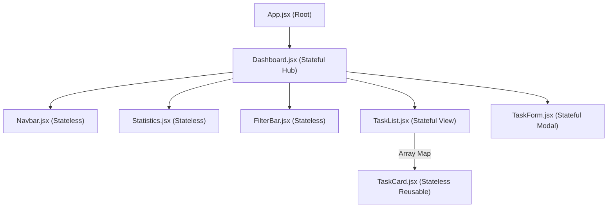

# 📘 STUDENT TASK MANAGER - PROJECT DOCUMENTATION & VIVA GUIDE

**Course**: Master of Computer Applications (MCA)  
**Subject**: Full Stack Web Development Laboratory  
**Project Category**: Academic Micro Project  
**Author / Candidate**: MCA Student  

---

## 1. Project Title
**STUDENT TASK MANAGER**: A Reactive Academic Coursework & Assignment Organizer with GraphQL, Node.js, Express, and MongoDB.

---

## 2. Introduction
In higher education institutions, particularly postgraduate computer applications curricula, students handle multiple subjects, laboratory assignments, seminar deadlines, and project submissions simultaneously. Tracking deadlines on paper or fragmented notes frequently leads to missed deadlines or disorganization.

The **Student Task Manager** is a full-stack, single-page web application engineered to streamline student productivity. It offers an intuitive dashboard where students can record, monitor, filter, update, and manage assignments across courses. Built using the modern MERN architecture combined with Apollo Server GraphQL, this project highlights clean component segregation, unidirectional data flow, declarative event handling, and schema-driven API integration using the native Fetch API.

---

## 3. Problem Statement
Existing generic to-do apps often suffer from either:
1. Over-complexity (heavy enterprise project management tools requiring complex project setup and team workflows).
2. Over-simplification (simple to-do lists lacking academic subject categorization, priority flags, deadline monitoring, or overdue indicators).
3. Monolithic or REST API limitations such as over-fetching, under-fetching, or tightly coupled endpoints.

Students require a focused, lightweight, responsive academic task organizer that provides instant visual status indicators (pending, completed, overdue), subject groupings, and immediate live synchronization with a persistent MongoDB database.

---

## 4. Project Objectives
1. **Academic Organization**: Enable students to add, edit, delete, and mark coursework assignments as completed.
2. **Deadline Management**: Implement automatic deadline tracking and visual flags for overdue and due-today tasks.
3. **Component-Based Architecture**: Demonstrate React functional components, distinguishing between stateful containers and stateless presentational components.
4. **Declarative Event Handling**: Illustrate `onClick`, `onChange`, and `onSubmit` event propagation in React.
5. **Schema-Driven API**: Design a robust GraphQL schema with strongly typed queries and mutations using Apollo Server v4.
6. **Native API Integration**: Demonstrate client-server GraphQL communication using the native browser `fetch()` API without third-party abstraction libraries.
7. **Persistent Data Storage**: Store and manipulate academic tasks reliably in MongoDB using Mongoose ODM with schema validation and virtual properties.

---

## 5. Technologies Used

| Layer | Technology | Version | Purpose |
|---|---|---|---|
| **Frontend Framework** | React.js | ^18.3.1 | Component-based interactive User Interface |
| **Build Tool** | Vite | ^6.0.1 | Fast ES Module development & bundle tool |
| **Styling** | CSS3 Custom Properties | Modern | Navy & Violet design system, flexbox, grid, animations |
| **Icons** | Lucide React | ^0.460.0 | Lightweight SVG icons |
| **Backend Runtime** | Node.js | v25+ / LTS | Server-side JavaScript runtime |
| **Web Server** | Express.js | ^4.21.2 | HTTP routing, CORS, and middleware hosting |
| **API Architecture** | Apollo Server | ^4.11.3 | GraphQL schema execution & request resolution |
| **GraphQL Engine** | GraphQL.js | ^16.10.0 | Type parsing, query validation, and AST handling |
| **Database** | MongoDB | v6+ / v7+ | NoSQL document database for task persistence |
| **ODM** | Mongoose | ^8.9.5 | Schema definition, validation, and database operations |
| **API Client** | Native Browser Fetch API | Built-in | GraphQL POST requests without external dependencies |

---

## 6. System Architecture

The application adopts a decoupled Client-Server architecture where the React Single-Page Application (SPA) communicates with the Node.js/Express server exclusively through GraphQL POST requests.

```mermaid
flowchart TD
    subgraph Browser ["Client: React SPA (Vite)"]
        UI["React Components\n(Dashboard, TaskList, TaskForm)"]
        FetchService["GraphQL Service\n(Native window.fetch API)"]
        UI -->|Calls Service Methods| FetchService
    end

    subgraph Server ["Server: Node.js & Express"]
        Apollo["Apollo Server v4 Engine\n(/graphql endpoint)"]
        TypeDefs["GraphQL TypeDefs\n(Schema & Types)"]
        Resolvers["Resolvers\n(Queries & Mutations)"]
        
        Apollo --> TypeDefs
        Apollo --> Resolvers
    end

    subgraph Database ["Data Tier: MongoDB"]
        Mongoose["Mongoose ODM\n(Task Model & Validation)"]
        MongoStorage[("MongoDB Database\n(student_task_manager)")]
        
        Mongoose <--> MongoStorage
    end

    FetchService -->|HTTP POST JSON\n(query, mutation, variables)| Apollo
    Apollo -->|JSON Response\n{ data, errors }| FetchService
    Resolvers <-->|Mongoose Queries\n(find, save, update, delete)| Mongoose
```

---

## 7. React Component Design

The frontend follows the **Presentational and Container Component Pattern**:
- **Container Components (Stateful)** manage data fetching, state updates, business logic, and error handling.
- **Presentational Components (Stateless)** receive data and event callbacks via `props` and render visual elements.



---

## 8. Stateful and Stateless Components

### Stateful Components

1. **`Dashboard.jsx`**:
   - **State**:
     - `tasks`: Array of task objects fetched from GraphQL.
     - `stats`: Object `{ total, completed, pending, overdue }`.
     - `isLoading`, `isSubmitting`: Boolean loading flags.
     - `errorMessage`: String error message when backend is offline.
     - `statusFilter`, `priorityFilter`, `searchQuery`: Filter states.
     - `isModalOpen`: Boolean controlling form modal visibility.
     - `editingTask`: Task object currently selected for updating, or `null`.
     - `toast`: Feedback notification `{ message, type }`.
   - **Hooks Used**: `useState`, `useEffect`, `useCallback`.

2. **`TaskForm.jsx`**:
   - **State**:
     - `formData`: Controlled state `{ title, description, subject, priority, dueDate }`.
     - `errors`: Object containing field-level validation error messages.
   - **Hooks Used**: `useState`, `useEffect` (for synchronizing initial values when editing).

3. **`TaskList.jsx`**:
   - **State**:
     - `viewMode`: Controls `'grid'` versus `'list'` layout presentation.
   - **Hooks Used**: `useState`.

### Stateless / Reusable Components

1. **`Navbar.jsx`**:
   - Receives `onOpenAddTask` callback and `currentDate` string via props.
   - Pure presentational header.
2. **`Statistics.jsx`**:
   - Receives `stats` object and `isLoading` boolean.
   - Renders metric cards and progress indicators without internal state.
3. **`FilterBar.jsx`**:
   - Receives current filter values and callback handlers (`onStatusChange`, `onPriorityChange`, `onSearchChange`, `onResetFilters`).
   - Delegates all user actions upstream.
4. **`TaskCard.jsx`**:
   - Receives single `task` item and callbacks (`onToggleStatus`, `onEdit`, `onDelete`).
   - Computes display formatting (e.g. overdue flags, badge styles) purely from props.

---

## 9. Event Handling Implementation

The application leverages standard synthetic event handlers in React:

### `onClick` Events
- **Add Task Button**: Triggers `handleOpenAddTask()` in `Navbar.jsx` and `Dashboard.jsx`.
- **Status Toggle**: Toggles task completion via `onToggleStatus(task.id)` in `TaskCard.jsx`.
- **Edit Task Button**: Passes target task object to `handleOpenEditTask(task)` to pre-populate modal.
- **Delete Task Button**: Prompts user confirmation and executes `handleDeleteTask(task.id)`.
- **Status Filter Tabs**: Switches active filter between `All`, `Pending`, and `Completed`.
- **View Mode Switcher**: Toggles between `grid` and `list` layouts in `TaskList.jsx`.

### `onChange` Events
- **Form Inputs**: Dynamically updates `formData[name]` in `TaskForm.jsx` while clearing validation errors.
- **Search Bar**: Debounced or direct updates to `searchQuery` in `FilterBar.jsx`.
- **Priority Dropdown**: Updates `priorityFilter` select value.

### `onSubmit` Events
- **Task Form Submission**: Intercepts HTML form submission with `e.preventDefault()`, validates all required fields, and dispatches either `createTask` or `editTask` mutation.

---

## 10. GraphQL Schema

The schema is defined using GraphQL Schema Definition Language (SDL) in `backend/graphql/typeDefs.js`:

```graphql
type Task {
  id: ID!
  title: String!
  description: String
  subject: String!
  priority: String!
  dueDate: String!
  status: String!
  createdAt: String
}

type TaskStats {
  total: Int!
  completed: Int!
  pending: Int!
  overdue: Int!
}

type Query {
  getTasks(status: String, priority: String, search: String): [Task!]!
  getTask(id: ID!): Task
  getTaskStats: TaskStats!
}

type Mutation {
  addTask(
    title: String!
    description: String
    subject: String!
    priority: String!
    dueDate: String!
  ): Task!

  updateTask(
    id: ID!
    title: String
    description: String
    subject: String
    priority: String
    dueDate: String
    status: String
  ): Task!

  deleteTask(id: ID!): Task!

  toggleTaskStatus(id: ID!): Task!
}
```

---

## 11. GraphQL Queries and Mutations

### Sample Queries

#### 1. Retrieve all tasks
```graphql
query GetAllTasks {
  getTasks(status: "All", priority: "All", search: "") {
    id
    title
    subject
    priority
    dueDate
    status
  }
}
```

#### 2. Retrieve task statistics
```graphql
query GetDashboardStats {
  getTaskStats {
    total
    completed
    pending
    overdue
  }
}
```

### Sample Mutations

#### 1. Add a new assignment
```graphql
mutation CreateAssignment {
  addTask(
    title: "Implement Graph Traversal in Java"
    description: "Submit BFS and DFS algorithms with complexity analysis"
    subject: "Data Structures & Algorithms"
    priority: "High"
    dueDate: "2026-11-20"
  ) {
    id
    title
    status
    createdAt
  }
}
```

#### 2. Toggle completion status
```graphql
mutation MarkTaskDone {
  toggleTaskStatus(id: "6730a84b1234567890abcdef") {
    id
    title
    status
  }
}
```

---

## 12. Resolver Implementation

Resolvers in `backend/graphql/resolvers.js` translate GraphQL operations into Mongoose queries:

- **`Query.getTasks`**: Builds dynamic query filter `{ status, priority, $or: [regex] }` and executes `Task.find(query).sort({ createdAt: -1 })`.
- **`Query.getTaskStats`**: Calculates counts using `Task.find({})` and filters for pending tasks past their `dueDate`.
- **`Mutation.addTask`**: Validates parameters and instantiates `new Task(...)`, calling `.save()`.
- **`Mutation.updateTask`**: Calls `Task.findByIdAndUpdate(id, updates, { new: true, runValidators: true })`.
- **`Mutation.deleteTask`**: Calls `Task.findByIdAndDelete(id)`.
- **`Mutation.toggleTaskStatus`**: Inverts `task.status` between `Pending` and `Completed` and saves changes.

---

## 13. MongoDB Integration

The MongoDB layer uses Mongoose with strict schema validation:
- **`title`**: String, required, trimmed, max 120 characters.
- **`subject`**: String, required, trimmed, max 80 characters.
- **`priority`**: String, enum `['High', 'Medium', 'Low']`, default `'Medium'`.
- **`dueDate`**: String (ISO format YYYY-MM-DD), required.
- **`status`**: String, enum `['Pending', 'Completed']`, default `'Pending'`.
- **Virtuals**: Maps MongoDB's internal `_id` to GraphQL's `id` field seamlessly.
- **Resilience**: The database connector (`config/db.js`) includes a zero-config fallback to an embedded in-memory MongoDB server, guaranteeing error-free viva demonstrations even if the local MongoDB daemon is temporarily inactive.

---

## 14. Application UI & Visual Layout

The UI implements a clean, modern aesthetic:
- **Header**: Navy blue theme with graduation cap badge, live academic date, and prominent CTA button.
- **Statistics Row**: 4 responsive metric cards with custom icons, color-coded themes, and a dynamic completion progress bar.
- **Filter Controls**: Unified search bar with clear button, priority selector dropdown, and pill-shaped status tabs (`All`, `Pending`, `Completed`).
- **Assignment Cards**: Rounded corners (`border-radius: 16px`), drop shadows, color-coded priority dots (🔴 High, 🟡 Medium, 🟢 Low), course pills, strikethrough styling for completed tasks, and red alert tags for overdue items.
- **Modal Dialog**: Centered modal with backdrop blur, inline input validations, auto-focus, and keyboard-friendly controls.

---

## 15. Conclusion
The Student Task Manager micro project successfully demonstrates an end-to-end, full-stack application built according to modern engineering practices. By replacing traditional REST endpoints with Apollo Server GraphQL and consuming the API through standard browser `fetch()`, the project minimizes boilerplate, guarantees strict type contracts, and provides a smooth, responsive student productivity workflow.

---

# 🎓 15 Likely MCA Viva Questions & Answers

### Q1: What is GraphQL, and how does it differ from a traditional REST API?
**Answer**: GraphQL is a query language and server runtime for APIs developed by Facebook. Unlike REST, which relies on multiple rigid URL endpoints (e.g. `/api/tasks`, `/api/stats`), GraphQL exposes a single endpoint (typically `/graphql`). Clients specify the exact fields they require, eliminating both over-fetching (retrieving unnecessary fields) and under-fetching (requiring multiple round trips).

### Q2: Why did we use the native Fetch API instead of Apollo Client or Axios in this project?
**Answer**: Using the native browser `fetch()` API demonstrates a deep understanding of HTTP and GraphQL fundamentals. A GraphQL request is simply a standard HTTP POST request with a JSON payload containing `query` and `variables`. Avoiding Apollo Client or Axios shows that GraphQL does not require complex libraries to communicate with the client.

### Q3: What is the difference between a GraphQL Query and a Mutation?
**Answer**:
- **Query**: Used for read-only operations to fetch data without modifying server state (analogous to HTTP GET in REST).
- **Mutation**: Used for write operations that create, update, or delete data on the server (analogous to HTTP POST, PUT, PATCH, DELETE in REST).

### Q4: What is the role of a GraphQL Schema and Type Definitions (typeDefs)?
**Answer**: The schema serves as the contract between client and server. Written in Schema Definition Language (SDL), `typeDefs` define all available object types (like `Task` and `TaskStats`), their fields, data types (`String`, `Int`, `ID`, `Boolean`), and available queries and mutations.

### Q5: What is a GraphQL Resolver?
**Answer**: A resolver is a backend function responsible for fetching or calculating the data for a specific field in the schema. When a client executes a query like `getTasks`, Apollo Server invokes the matching resolver function in `resolvers.js`, which queries MongoDB via Mongoose and returns the result.

### Q6: What is the difference between a Stateful and a Stateless component in React?
**Answer**:
- **Stateful Components** (e.g., `Dashboard.jsx`, `TaskForm.jsx`) manage and preserve their own dynamic state using hooks like `useState`. They handle data fetching, user input state, and lifecycle events.
- **Stateless / Presentational Components** (e.g., `Navbar.jsx`, `TaskCard.jsx`, `Statistics.jsx`) have no internal state; they receive data and callback functions via `props` and purely render UI.

### Q7: What are React Hooks, and which ones are used in this project?
**Answer**: Hooks are built-in functions introduced in React 16.8 that allow functional components to use state and lifecycle features. In this project:
- `useState`: Manages local reactive state (form values, task lists, filter selections).
- `useEffect`: Manages side-effects, such as fetching data from the backend when the dashboard loads or when filters change.
- `useCallback`: Memoizes functions to prevent unnecessary re-creations across renders.

### Q8: How does event handling work in React? Give examples from the project.
**Answer**: React uses a synthetic event system that wraps native browser events for cross-browser consistency:
- `onClick`: Used when clicking buttons to add a task, toggle completion, or delete an assignment.
- `onChange`: Used on input fields and dropdowns to update React state on every keystroke or selection.
- `onSubmit`: Handled on the form element, where `e.preventDefault()` halts default page refresh and dispatches the GraphQL mutation.

### Q9: How do props enable communication between parent and child components?
**Answer**: Props (short for properties) allow unidirectional data flow from parent to child. The parent passes data downwards (e.g., `Dashboard` passes `task` to `TaskCard`), and passes callback functions (e.g., `onDelete`) so the child can notify the parent when an action occurs.

### Q10: What is Mongoose, and why do we use it with MongoDB?
**Answer**: Mongoose is an Object Data Modeling (ODM) library for MongoDB and Node.js. While MongoDB is schema-less by nature, Mongoose enforces structure, type checking, validation rules (like required fields and enums), default values, and virtual attributes at the application layer.

### Q11: How is the MongoDB `_id` mapped to the GraphQL `id` field?
**Answer**: MongoDB natively identifies documents using an `_id` of type `ObjectId`. In our Mongoose model (`models/Task.js`), we defined a virtual getter `taskSchema.virtual('id').get(function() { return this._id.toHexString(); })`. In the GraphQL schema, we expose this as `id: ID!`.

### Q12: How are overdue tasks detected and calculated?
**Answer**: In `resolvers.js` and `TaskCard.jsx`, the system compares the task's `dueDate` string against today's date in `YYYY-MM-DD` format. If `task.status === 'Pending'` and `task.dueDate < todayString`, the task is flagged as overdue.

### Q13: What is the purpose of `e.preventDefault()` in form submission?
**Answer**: In standard HTML, submitting a form causes the browser to reload the page or navigate to the form's `action` URL. Calling `e.preventDefault()` suppresses this default behavior, allowing React to validate the data and send an asynchronous fetch request without reloading.

### Q14: How does Apollo Server integrate with Express?
**Answer**: We use `@apollo/server` along with `expressMiddleware` from `@apollo/server/express4`. We create an Apollo Server instance with `typeDefs` and `resolvers`, start it, and mount it as an Express middleware handler at the `/graphql` route.

### Q15: What happens if an error occurs during a GraphQL request?
**Answer**: GraphQL HTTP responses typically return a `200 OK` status code even when errors occur. The response body contains an `errors` array alongside or instead of the `data` object. Our `graphqlService.js` checks `if (result.errors)`, extracts the error messages, and throws a JavaScript exception to alert the user via toast notifications.
